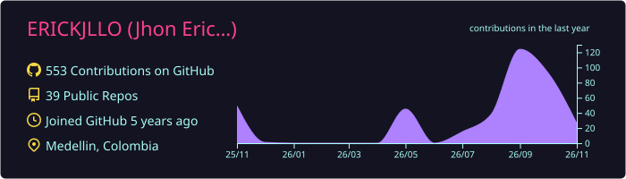
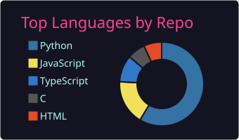
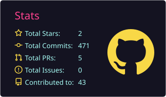

### Building software, learning continuously, and turning ideas into real projects.

Systems Engineering and Scientific Computing student at **Universidad de Medellín**  
Based in **Medellín, Colombia**

## About me

I enjoy building applications from the interface to the backend, understanding how systems work, and improving the way software is developed and delivered.

- **Software development:** web applications, REST APIs, authentication, databases, and automated testing.
- **DevOps and observability:** hands-on projects with Docker, Jenkins pipelines, Prometheus, Grafana, and the ELK Stack.
- **Cybersecurity and robotics:** exploring ethical hacking with Kali Linux and programming VEX EDR robots using RobotC.
- **Currently growing in:** full-stack development, software architecture, cloud technologies, and secure development practices.

## Tech stack

**Languages**

**Frontend**

**Backend & databases**

**DevOps, monitoring & tools**

**Additional technologies & environments**

These are technologies I have used in coursework, personal projects, or practical exercises; experience levels vary.

## Featured work

<table>
  <tr>
    <td width="50%" valign="top">
      <h3><a href="https://github.com/MarioFer299/Gestion-academica-from">FocusLab</a></h3>
      
<strong>Academic management platform</strong>

      
Designed and developed frontend views for authentication, dashboards, subjects, academic periods, and learning resources.

      
      
      
      
<a href="https://github.com/MarioFer299/Gestion-academica-from"><strong>Explore frontend repository →</strong></a>

    </td>
    <td width="50%" valign="top">
      <h3>Delta API</h3>
      
<strong>Personal backend project</strong>

      
Built REST endpoints, authentication, API documentation, automated tests, health checks, and application metrics.

      
      
      
      
<strong>Backend · Testing · Metrics</strong>

    </td>
  </tr>
  <tr>
    <td width="50%" valign="top">
      <h3><a href="https://github.com/ERICKJLLO/spring-petclinic">Spring PetClinic CI/CD</a></h3>
      
<strong>Build and delivery automation</strong>

      
Created a Jenkins pipeline to build a Java application and package it into a Docker image.

      
      
      
<a href="https://github.com/ERICKJLLO/spring-petclinic"><strong>Explore repository →</strong></a>

    </td>
    <td width="50%" valign="top">
      <h3>Observability labs</h3>
      
<strong>Metrics and centralized logging</strong>

      
Configured monitoring dashboards and application log collection across local containerized environments.

      
      
      
      
<strong>Monitoring · Logs · Docker</strong>

    </td>
  </tr>
</table>

## GitHub activity

### Contribution animation

<picture>
  <source media="(prefers-color-scheme: dark)" srcset="https://raw.githubusercontent.com/ERICKJLLO/ERICKJLLO/output/github-snake-dark.svg" />
  <source media="(prefers-color-scheme: light)" srcset="https://raw.githubusercontent.com/ERICKJLLO/ERICKJLLO/output/github-snake.svg" />
  
</picture>

## Beyond code

I like understanding how things work, experimenting with robotics, and solving practical problems. I also enjoy the challenge of learning a new tool and putting it to use in a real project.

## Find me online

**Have a project in mind, or just want to talk tech?**

  
  

  
  
  
  
  

Open to collaborating, learning, and building useful things.

